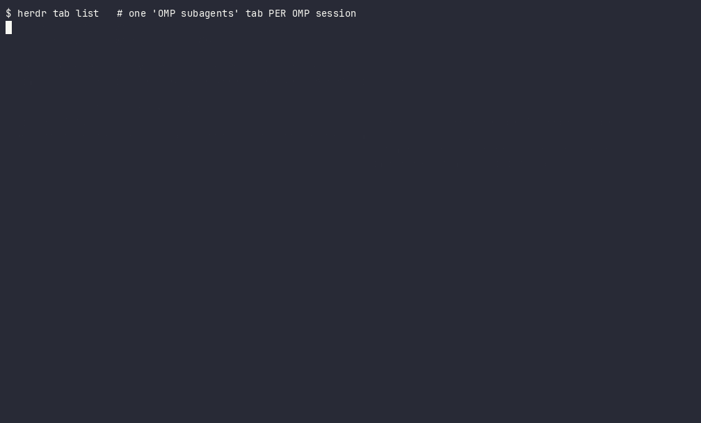

<div align="center">

# 🪟 herdr-omp-lens

**A window into OMP's native subagents — from inside Herdr.**

[](https://github.com/fabzter/herdr-omp-lens/releases)
[](docs/analysis/dod-v1-report.md)
[](LICENSE)
[](https://omp.sh)
[](https://herdr.dev)

When you delegate work in [OMP](https://omp.sh), it spins up native subagents — headless workers
doing research, edits, and reviews in the background. They live inside one terminal pane.
If you work in [Herdr](https://herdr.dev), you already think in tabs and panes.

**herdr-omp-lens gives those workers a second screen**: a tab in your workspace showing who's
working, what they're doing, and what they found — rendered with **OMP's own TUI components**.
No duplicate agents. No focus theft. Nothing leaves your machine.

OMP stays the boss. It owns the workers and their results. This is just a window.


</div>

---

## ✨ What you get

- **One tab per OMP session.** Run several OMP sessions in one workspace — each gets its own
  `OMP subagents` tab (additional ones suffixed `· <id>`), never a shared or hijacked view.
  Opens with `--no-focus` on the first delegation; close it and the *next* subtask reopens exactly one.
- **OMP's own look.** The roster is painted by OMP's actual TUI component (`@oh-my-pi/pi-tui`'s
  `agent` painter, pinned to your installed OMP version); the selected worker's detail and live
  transcript (`omp render`) fill the right column. Fixed full-viewport frame: the footer stays
  locked at the bottom, always.
- **Finished workers stay visible.** Completed workers remain listed — OMP-hub style — even after
  OMP reaps them. `e` collapses them on demand. Both columns stay open at all times.
- **Scroll everything.** `J`/`K`, `PgUp`/`PgDn`, `g`/`G` — or just the **mouse wheel** — scroll the
  transcript; `↑ N earlier lines` / `↓ N more lines` keep you oriented; `G` returns to live-follow.
- **History that knows it's history.** After an OMP restart, saved transcripts are still there,
  labelled `[not-live]` — the viewer never implies execution that isn't happening.
- **Read-only by construction.** No key, click, or frame can steer, revive, or cancel a worker.
  The bridge rejects every `control.*` frame at the handshake boundary.
- **Fail-soft — degraded mode (D1).** If the native bus is unavailable, one warn notice and
  artifact-scan discovery. If Herdr or the bridge dies mid-turn, your OMP turn completes normally.

### Scroll the transcript — keys or wheel


### Two OMP sessions, two tabs, zero hijack



## 📦 Install

**Requirements:** OMP 19.2.1 (the design pin — re-pinned 19.0.1 → 19.1.1 per OI-1 → 19.2.1 per
OI-4, owner decisions 2026-11-25), Herdr 0.9.5, and [Bun](https://bun.sh) on `PATH`. The extension activates only inside a Herdr-managed pane
(`HERDR_ENV=1`); outside Herdr it is a complete no-op.

```sh
# from a clone of this repo
omp plugin link /path/to/herdr-omp-lens
```

> **Inside a Herdr pane, strip `HERDR_*` for the install command** — the installer otherwise waits
> on handles a running extension keeps open (install-time only; runtime is unaffected):
>
> ```sh
> env -u HERDR_ENV -u HERDR_PANE_ID -u HERDR_TAB_ID -u HERDR_WORKSPACE_ID \
>     -u HERDR_SOCKET_PATH -u HERDR_BIN_PATH \
>     omp plugin link /path/to/herdr-omp-lens
> ```
>
> To keep a daily profile untouched, link into a disposable profile instead:
> `omp --profile=<name> plugin link <path>` (the `--profile` flag comes *before* the subcommand).

Then **restart your OMP session** and delegate a task — the `OMP subagents` tab opens by itself.

## 🚀 Use

Delegate anything in OMP (`task` tool). The overview opens on the first spawn.

| Command | Effect |
| --- | --- |
| `/lens` | Open the overview (no-op if already open; never moves focus). |
| `/lens split <workerId>` | Open a no-focus, worker-scoped split for that worker. Closing it never touches the worker. |

### Keyboard (read-only by construction)

| Key | Action |
| --- | --- |
| `j` / `k` or `↑` / `↓` | Select an agent |
| `J` / `K` | Scroll transcript down / up |
| `PgDn` / `PgUp` | Scroll a page |
| `g` / `G` | Transcript top / back to live-follow |
| **mouse wheel** | Scroll transcript (Herdr forwards it) |
| `e` / `Enter` / `Space` | Collapse / expand the finished section |
| `t` | Toggle thinking display (hidden by default) |
| `r` | Refresh |
| `q` / `Ctrl-C` | Quit the viewer (never the worker) |

There is no key that sends anything to a worker.

**Scope:** v1 shows the **direct** `task` workers of the **current** OMP session. Nested children
and other sessions' workers are excluded by design; workers started before the extension activated
are not retroactively observed (see [limitations](#-limitations)).

## 🔍 How it works

An in-process OMP extension subscribes to `task:subagent:{event,progress,lifecycle}` through
`pi.events`, keeps a direct-worker roster, and publishes it over a **local unix-socket NDJSON
bridge** (per-session `0700` dir, socket `0600`, unlinked on exit). A small viewer CLI — launched
into the Herdr tab through a guarded, no-focus adapter — connects, receives a `hello` snapshot plus
deltas, and renders with OMP's own `pi-tui` components. Nothing is spawned by the viewer; nothing
leaves the machine.

```
OMP session ──pi.events──▶ extension ──unix socket──▶ viewer (Herdr pane)
   owns workers            roster + bridge            pi-tui render, read-only
```

See [`docs/architecture.md`](docs/architecture.md) for the component map, data flow, invariants and
degraded-mode behavior, and the [SDD](docs/superpowers/specs/2026-11-19-herdr-omp-lens-design.md)
for the full design.

## ✅ Quality

- **501 tests / 0 fail** across 36 files; `tsc --noEmit` and `biome check` clean.
- **Tamper-proven invariants**: no duplicate workers, worker survives viewer close, no focus theft,
  no `control.*` frames, read-only keyboard map — each guard test fails on a deliberate sabotage.
- **Isolated-session E2E** in disposable Herdr workspaces; daily workspaces proven byte-identical
  before/after every run.
- Evidence pack: [DoD-v1 report](docs/analysis/dod-v1-report.md) ·
  [E2E evidence](docs/analysis/e2e-evidence.md) ·
  [clean-profile install](docs/analysis/clean-profile-install.md).

Regenerate the evidence report with `bun scripts/gen-dod-report.ts`.

### Verified commands

Every command below was executed on 2026-11-26 at commit `a994629` (OMP 19.2.1 / Herdr 0.9.5) and
its output is quoted verbatim:

```console
$ bun test
 501 pass
 0 fail
 1832 expect() calls
Ran 501 tests across 36 files. [3.82s]

$ bun run typecheck          # tsc --noEmit — clean, no output

$ bun run lint
$ biome check src tests
Checked 68 files in 24ms. No fixes applied.

$ bash scripts/run-e2e.sh    # safe mode — disposable round-trip, dailies untouched
checks    : 7 pass, 0 fail, 0 manual, 5 skipped, 5 notes
```

## Limitations

Recorded known limitations — each a deliberate v1 boundary or an honest gap with a named capture:

1. **History counters are not reconstructable.** Persisted JSONL carries roster fields and terminal
   status, not the live `counters` stream; historical rows show counters absent, labelled *not live*.
2. **`queued` / `idle` / `parked` transitions** are mapped verbatim if OMP emits them, but no
   reachable trigger was found on the pinned build (see
   [caveat closure](docs/analysis/phase-0-caveat-closure.md)).
3. **Pre-activation workers** are not observed — there is no registry snapshot for extensions.
4. **Herdr-server-restart layout restore** is a v2 horizon item; an *OMP* restart reuses and rebinds
   the surviving tab.
5. **TUI `detached` variance** is unconsumed (harmless but unverified).

Full list with evidence: [DoD report §Known limitations](docs/analysis/dod-v1-report.md).

## 🗺️ Roadmap

- **v1 — "The Window" (this release):** read-only observation, OMP-look two-column frame,
  persistent finished rows, transcript scroll (keys + wheel), one tab per session.
- **v2 — "The Console" (horizon):** safe interactive control — steer, follow up, revive, stop —
  routed back to the session that owns the worker.

## 📚 Documentation

- [Architecture notes](docs/architecture.md) — components, data flow, invariants, degraded mode.
- [Software Design Document](docs/superpowers/specs/2026-11-19-herdr-omp-lens-design.md) — source of truth.
- [DoD-v1 evidence report](docs/analysis/dod-v1-report.md) — requirement matrix and sign-off block.
- [Isolated-session E2E evidence](docs/analysis/e2e-evidence.md) — runs, findings, live witnesses.
- [Clean-profile install + version discipline](docs/analysis/clean-profile-install.md).
- [Phase 0 caveat closure](docs/analysis/phase-0-caveat-closure.md) — what the bus really emits.
- [Seam research](docs/analysis/research-seams.md) · [ADR-0001](docs/adr/0001-observation-seam.md).
- [Contributing](CONTRIBUTING.md) — dev setup, tests, review gates.

## 🎬 Showcase recordings

The GIFs above are **real recordings of the actual viewer** (asciinema → agg), reproducible from
this repo: `bun scripts/showcase/driver.ts <overview|scroll>` drives the real `runViewer` against a
scripted local bridge with demo data; the multi-session capture runs two real OMP agents in a
disposable Herdr workspace. Sources: [`scripts/showcase/`](scripts/showcase/),
[`docs/assets/`](docs/assets/) (`.cast` + `.gif`).

## License

[MIT](LICENSE) © 2026 Fabrizio Hernandez.

---

<div align="center">

Built with care for people who live in their terminal.
Be kind to your workers; they're doing their best. 🪟

</div>
